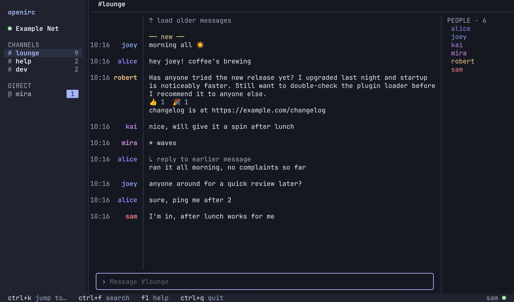
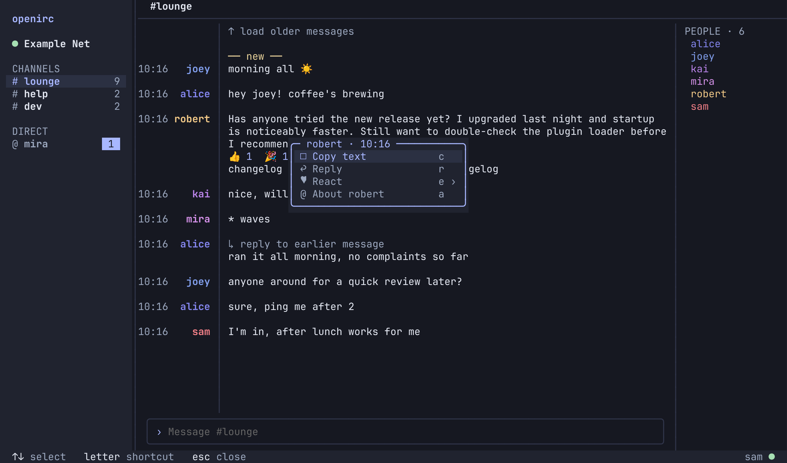
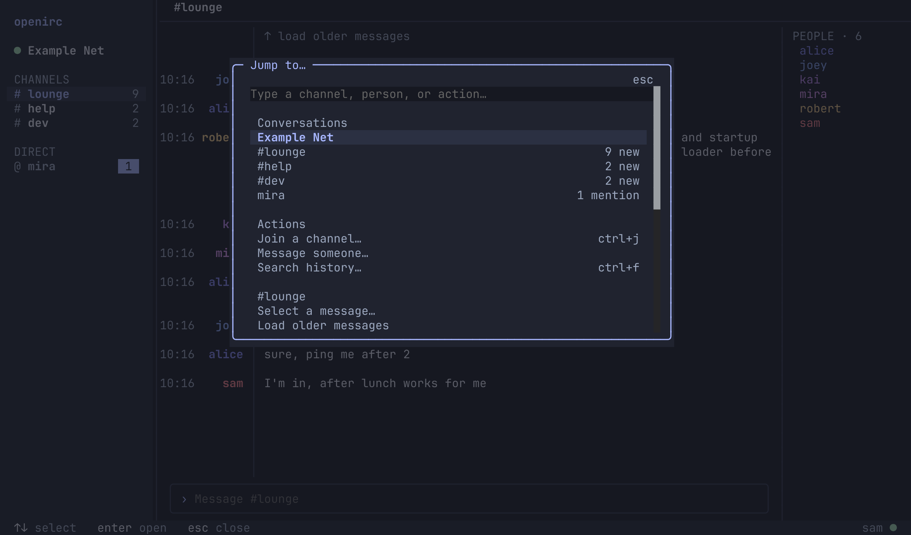
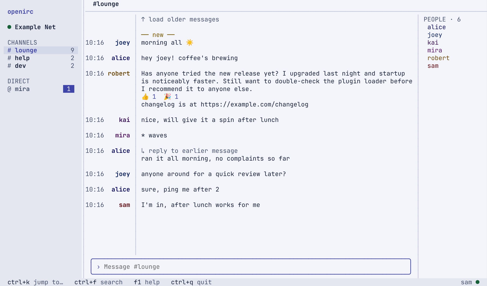

# OpenIRC

A friendly terminal IRC client for Linux and macOS. It has a channel/DM sidebar, one conversation at a time, and full mouse support with keyboard shortcuts throughout. Built with [Bun](https://bun.sh), [SolidJS](https://www.solidjs.com) and [OpenTUI](https://github.com/sst/opentui).

[](https://github.com/benvinegar/opentui-irc/actions/workflows/ci.yml)
[](LICENSE)

> **Status: alpha.** It's the author's daily driver, but expect rough edges and breaking config changes before 1.0.



## Why OpenIRC

- **Easy for newcomers.** Add a network, join a channel and start chatting from menus. You don't need to know slash commands, but `/help` lists them.
- **Calm layout.** Grouped messages, a sidebar with unread and mention badges, a member list on wide windows, and one footer showing the keys you can use right now.
- **Modern IRC where the server supports it.** IRCv3 chat history, replies, reactions, typing indicators, read markers and message removal. Each one turns on only when the server offers it; the rest of IRC works as usual.
- **Safe by default.** Verified TLS, and SASL only over TLS. Passwords live in your OS keychain or an environment variable, never in plaintext config. Uncertain sends are never replayed automatically.
- **Agents can configure it.** A versioned JSON control API lets your coding agent read the config schema, preview changes and apply them, even while the client is running.

## Screenshots

| Click a message for actions                                                  | Ctrl+K to jump anywhere                                                            |
| ---------------------------------------------------------------------------- | ---------------------------------------------------------------------------------- |
|  |  |

<details>
<summary>Light theme</summary>



</details>

Screenshots come from a local test server with made-up users.

## Install

Requires [Bun](https://bun.sh) 1.3.14 or newer.

```sh
git clone https://github.com/benvinegar/opentui-irc.git && cd opentui-irc
bun install --frozen-lockfile
bun link        # adds `openirc` to your PATH (~/.bun/bin)
```

`bun link` runs straight from the checkout. To update, `git pull` (and `bun install` if dependencies changed). To uninstall, run `bun unlink`.

**Standalone binary:** run `bun run build` to get `dist/openirc`, a single executable that needs neither Bun nor the source. Copy it anywhere on your PATH. It only runs on the OS and CPU it was built on.

## Quick start

```sh
openirc
```

1. Choose **Set up a network**. Presets fill in Libera.Chat and OFTC, or enter any TLS server.
2. Pick a nickname. Optionally add your SASL account.
3. Connect, then press **Ctrl+J** to join a channel.

| Key                 | Action                             |
| ------------------- | ---------------------------------- |
| Ctrl+K              | Switch conversation / more actions |
| Ctrl+J              | Join a channel                     |
| Ctrl+F              | Search local history               |
| Enter / Shift+Enter | Send / new line                    |
| Tab                 | Complete nicknames and commands    |
| F1                  | Help                               |
| Ctrl+Q              | Quit                               |

Click a message to copy, reply, react or open links. Click a nickname to see who they are. Drag across text to copy it.

## Configuration

Settings are JSONC files you can edit by hand, change in the in-app Settings screen, or change through the control CLI:

```sh
openirc config get                                   # current settings
openirc config schema                                # every setting, with types and defaults
openirc config set tui.density '"comfortable"' --dry-run
openirc config set tui.density '"comfortable"'      # applies live if the client is running
openirc --check-config                               # validate the files
```

| Data     | Location                                                              |
| -------- | --------------------------------------------------------------------- |
| Settings | `${XDG_CONFIG_HOME:-~/.config}/openirc/openirc.jsonc` and `tui.jsonc` |
| History  | `${XDG_DATA_HOME:-~/.local/share}/openirc/history.sqlite` (Linux)     |
|          | `~/Library/Application Support/OpenIRC/history.sqlite` (macOS)        |

To have a coding agent set things up for you, point it at [docs/AGENT_GUIDE.md](docs/AGENT_GUIDE.md). By default the control socket can inspect and configure. Reading messages, sending chat and destructive actions each need a separate, explicit grant.

## Good to know

- **History is local plaintext SQLite**, kept for 30 days by default. You can turn off logging in Settings.
- **Closing the client disconnects.** There's no background service; use a bouncer if you want to stay online.
- **Nicknames aren't identities.** DMs are addressed by nickname, which anyone can take later. Check WHOIS before sharing anything private.
- **No link previews.** Nothing is fetched automatically, and opening a link asks first.
- **Not included:** plugins, scripting, DCC, moderation tools, split panes.

## Docs

- [Agent guide](docs/AGENT_GUIDE.md) and [control API](docs/CONTROL.md)
- [Security and privacy model](docs/SECURITY.md)
- [Architecture](docs/ARCHITECTURE.md), [contracts](docs/CONTRACTS.md) and [decisions](docs/DECISIONS.md)
- [Product plan](docs/PLAN.md) and [implementation status](docs/IMPLEMENTATION.md)
- [IRC behaviour test matrix](docs/IRC_TEST_MATRIX.md)
- [Changelog](CHANGELOG.md)

## Contributing

Bug reports and pull requests are welcome. Read [CONTRIBUTING.md](CONTRIBUTING.md) first. In short:

```sh
bun install --frozen-lockfile   # also installs the pre-commit hook
bun run check                   # format, lint, types and every test
```

Node.js 24 is also needed for the Vitest suite. Tests use local fake IRC servers and never connect to public networks.

## Security

Please report vulnerabilities privately; see [SECURITY.md](SECURITY.md).

## License

[MIT](LICENSE) © Ben Vinegar
